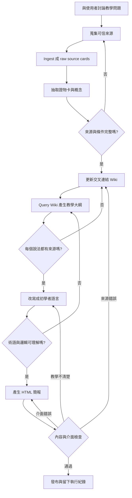

# Loop／Graph 設計

## Graph

## 三個主要 Loop

### 1. 證據完整性 Loop

`蒐集 → ingest → 證物卡 → 來源檢查`

如果來源無法支持數字、比較或因果語氣，就補資料、降低語氣或刪除說法。這個 loop 避免錯誤在簡報完成後才被發現。

### 2. Wiki 查詢 Loop

`query → 說法—來源對照 → lint → query`

Wiki 查詢的每個回答都必須列出來源 ID。找不到來源的句子不會進入簡報大綱，而是退回 Wiki 頁補足脈絡。

### 3. 教學與介面 Loop

`初學者改寫 → HTML → 瀏覽測試 → 修正`

內容錯誤回到 Wiki；內容太難回到改寫；只有排版或互動問題時才回到 HTML。這樣不會因為一個按鈕失效而重新生成內容。

## 為什麼這樣設計？

最危險的不是版面問題，而是 LLM 在摘要時遺失研究條件。例如把「特定資料集的 AUC」改寫成「模型有固定的準確率」。因此檢查被放在證物卡與大綱之間，而不是只在成品最後檢查。

